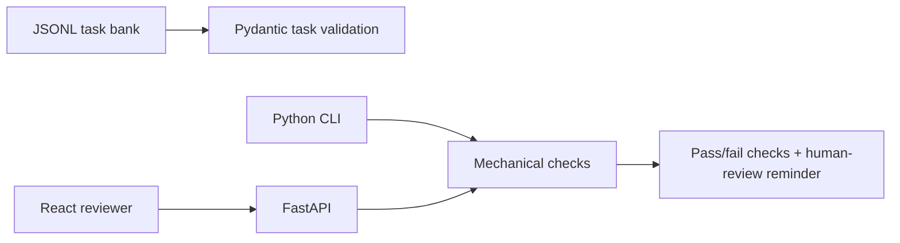

# AI Instruction-Following and Reasoning Assessment Suite

An independent portfolio project that checks explicit response constraints mechanically while leaving reasoning validity and factual correctness for human review. It is not affiliated with Handshake or an AI lab.

Status: **Implemented, tested, and frontend build verified.** Not deployed. Public GitHub repository: https://github.com/JPPREMKUMAR/ai-instruction-following-benchmark.

## Features

- JSONL task bank with expected behavior, reference reasoning, and ambiguity labels.
- Checks for exact bullet count, word limit, required phrases and sections, valid JSON, and required JSON keys.
- CLI, FastAPI endpoints, and React review interface.
- Synthetic tasks for formatting, arithmetic with units, underdetermined prompts, and structured JSON output.

## Architecture



## Run

Use Python 3.12 and Node.js 22 or compatible versions. Copy `.env.example` to `.env` to configure `TASK_BANK_PATH`; the default reads the bundled JSONL bank. The CLI/API load this local dotenv file.

```powershell
python -m venv .venv
.\.venv\Scripts\Activate.ps1
pip install -r requirements.txt
uvicorn app.main:app --reload
```

API docs: `http://127.0.0.1:8000/docs`.

CLI:

```powershell
python -m app.cli --task-id format-two-bullets --response-file examples/response.txt --output reports/result.json
```

The React interface lives in `frontend/`; install with `npm ci` and run `npm run dev` in a separate terminal. It calls the local API.

## Tests and interpretation

Run `python -m pytest -q`. The mechanical pass means only that configured checks passed. It does not prove truth, sound reasoning, or overall instruction compliance. Human judgments should use a rubric for correctness, reasoning validity, constraint adherence, and uncertainty handling. Sample task counts must not be presented as model benchmark results. See [`docs/test-report.md`](docs/test-report.md) and [`docs/evaluation-methodology.md`](docs/evaluation-methodology.md).

## Limitations and future work

Current mechanical checks are intentionally narrow; required phrase checks do not establish semantic equivalence. JSON keys are validated, but JSON Schema types and nested constraints are not yet supported. API evaluation history is held in memory and resets when the process restarts. No paid API is needed.

See [`docs/requirements.md`](docs/requirements.md) for MVP acceptance criteria, [`docs/architecture.md`](docs/architecture.md) for data flow, [`docs/demo.md`](docs/demo.md) for a short walkthrough, [`docs/response-quality-examples.md`](docs/response-quality-examples.md) for labeled cases, and [`docs/deployment.md`](docs/deployment.md) for the current hosting assessment.

## License

MIT. See `LICENSE`.

