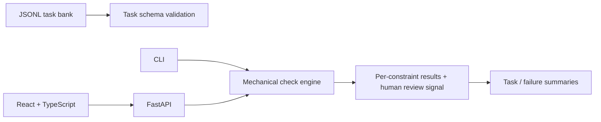

# Architecture

The task bank is the reference source. A shared check engine evaluates only explicit mechanical constraints and returns per-check evidence; CLI and API both use it. The UI presents outputs with a reminder that semantics, truth, and reasoning quality require human judgment. Reports are in-memory for the current process and reset on restart.

This is a local assessment suite, not a production benchmark service. It has no authentication or durable review store, and its small synthetic task bank is not representative of general model performance.
